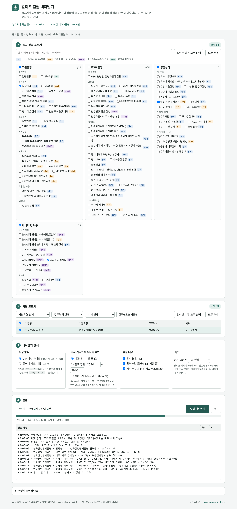

# 알리오 일괄 내려받기 (alio-bulk)

공공기관 경영정보 공개시스템(알리오, www.alio.go.kr)의 항목별 공시 자료를 **여러 기관 × 여러 항목**에 걸쳐 한 번에 내려받는 웹앱입니다. 설치할 것이 없고, 브라우저만 있으면 됩니다.

- 사이트: https://alio-bulk.vercel.app
- 같은 기능의 다른 판: [파이썬 데스크톱판 alio-crawler](https://github.com/giovinazo/alio-crawler) · [MCP판 alio-mcp](https://github.com/giovinazo/alio-mcp)



## 쓰는 법

1. **공시 항목 고르기**: 93개 항목을 대분류별로 보여 줍니다. 검색해서 체크합니다.
2. **기관 고르기**: 355개 기관을 기관유형·주무부처·지역·이름으로 거르고 체크합니다.
3. **내려받기 방식**: ZIP 하나로 받을지, 폴더에 바로 쓸지(크롬·엣지), 수시·게시판형은 최신 1건만 받을지 연도 범위로 받을지 고릅니다.
4. **일괄 내려받기**: 진행 기록과 집계를 보면서 기다립니다. 중간에 멈춰도 그때까지 받은 것은 저장됩니다. 실패한 것만 다시 받을 수 있습니다.

받은 파일은 `항목/기관/파일` 순서의 폴더로 정리되고, 맨 위에 `_수집목록.csv`(받은 파일·없음·실패 전부)가 들어갑니다.

## 항목 종류별로 받는 것

| 종류 | 항목 수 | 받는 것 |
|---|---|---|
| 정기 | 58 | 현재 공시된 보고서 PDF + 부속 첨부(감사보고서·안전경영책임보고서 등) |
| 수시 | 19 | 기관별 글(최신 1건 또는 기간)의 PDF + 첨부 |
| 게시판 | 15 | 글마다 첨부파일 + 본문·바깥 링크 텍스트(.txt). 감사원·국회 지적사항, 경영평가, 채용·입찰 공고 등 |
| 규정 | 1 | 내부규정 목록을 훑어 규정마다 최신 파일(.hwp·.pdf) |

## 동작 방식

- 알리오는 다른 사이트에서 직접 부를 수 없게 되어 있어(교차 출처 제한), 버셀 함수 하나(`api/alio.js`)가 **허용된 조회·내려받기 경로만** 알리오에 그대로 전달합니다. 파일은 서버에 저장하지 않고 스트리밍으로 흘려보냅니다.
- 브라우저가 파일을 하나씩 받아 [client-zip](https://github.com/Touffy/client-zip)으로 ZIP을 만듭니다. 크롬·엣지에서는 디스크에 바로 써서 메모리를 거의 쓰지 않습니다. 다른 브라우저는 메모리에 모은 뒤 저장합니다.
- 알리오 호출 규약(기관 목록 `itemOrganListJung`, 글 목록 `itemReportListSusi`, 첨부 `itemReportFiles`, 게시판 `itemBoard{번호}.do`, 내부규정 `findRuleList`→`findRuleDtl`→`rulefiledown`)은 alio-crawler·alio-mcp의 `alio_core`와 같습니다.
- 첫 화면은 `public/data/`의 정적 사본(항목·기관 목록)을 먼저 보여 주고, 사본이 7일 넘게 묵었으면 뒤에서 새로 받습니다.

## 알아 둘 것

- 한 번 실행에 2GB까지 받습니다. 넘으면 받은 것까지 저장하고 멈춥니다. 수십 GB 단위 전수 수집은 파이썬 데스크톱판이나 MCP판을 쓰세요(내 컴퓨터가 직접 받아 서버 비용이 들지 않습니다).
- 내려받은 파일은 버셀 CDN에 캐시됩니다(20MB 이하, 첨부 30일·본문 PDF 7일·최신 규정 1일). 같은 파일을 다른 사람이 받으면 함수를 거치지 않습니다.
- 알리오 서버에 부담을 주지 않도록 동시 요청 수는 3 이하를 권합니다. 거부 응답이 이어지면 자동으로 1분 쉬었다가 계속하고, 그래도 계속되면 멈춥니다.
- 정기공시는 현재 공시된 최신 보고서만 받습니다. 과거 연도 보고서는 알리오 사이트에서 직접 받아야 합니다.
- 수시·게시판형 "전체" 범위는 기관·항목당 300건(30쪽)까지만 받습니다. 입찰공고처럼 글이 수천 건인 항목은 연도 범위를 쓰세요.
- 공개 자료만 다루며 로그인·개인정보와 무관합니다. 이 도구는 알리오와 무관한 개인 제작물입니다.

## 개발

```bash
npm run dev                 # http://127.0.0.1:8787 (3시간 뒤 자동 종료)
npm test                    # 중계 함수 점검 19건
python3 tests/e2e.py        # 브라우저 자동 시험 (Playwright 필요)
node scripts/snapshot.mjs   # 항목·기관 정적 사본 갱신 (배포 전)
vercel --prod               # 배포
```

구성: `api/alio.js`(중계 함수, 의존성 없음) · `public/`(정적 화면, 빌드 없음) · `vercel.json`(서울 리전, 함수 300초, 검색엔진 비노출).

## 라이선스

MIT. 포함된 client-zip 도 MIT 입니다(`public/vendor/`).
